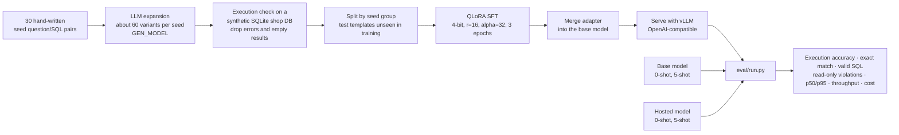

# Text-to-SQL LoRA Fine-tuning

Does QLoRA fine-tuning a small open model beat prompting for text-to-SQL on a fixed schema? The repository builds the dataset, trains the adapter and compares five systems on quality, cost, latency and GPU hours.


> **Status: pipeline written, nothing trained or measured yet.** Dataset generation, training, merging and the evaluation runner are implemented, and 4 unit tests cover the database, the result comparison and the prompt helpers. No model has been trained and no system has been evaluated, so this README reports **no accuracy, latency or cost numbers**. See [Status and findings](#status-and-findings).

## Pipeline



A picture version is in `docs/architecture.svg`. Every system goes through the same OpenAI-compatible client (`src/text2sql/llm.py`), so hosted APIs, vLLM and a gateway are compared on equal terms.

## The five systems compared

| System | How |
|---|---|
| base, 0-shot | the base model with the schema prompt only |
| base, 5-shot | the same, with 5 examples from distinct training groups |
| hosted, 0-shot and 5-shot | a hosted API model through the same client |
| fine-tuned | the merged QLoRA model, 0-shot |

Metrics: **execution accuracy** (result-set match, order-insensitive), exact match (a weak signal), valid-SQL rate, read-only violations, p50 and p95 latency, throughput, and cost per 1k requests.

## Quickstart

```bash
cp .env.example .env            # LLM_BASE_URL, LLM_API_KEY, GEN_MODEL, prices
pip install -e ".[dev]"         # add ,train on the GPU machine
make data                       # build the DB, expand the seeds, split
make run MODEL=<base>           # serve a model (needs vllm), then in another shell:
make eval NAME=base-0shot MODEL=<base> SHOTS=0
make train && make merge        # needs a CUDA GPU and the train extra
make run MODEL=runs/merged && make eval NAME=finetuned MODEL=runs/merged
make table                      # markdown table of the latest result per system
make test                       # lint and unit tests, no GPU or network
```

Training defaults (`train/config.yaml`): base `Qwen/Qwen2.5-Coder-1.5B-Instruct` (the model id was not verified; confirm it on Hugging Face), 3 epochs, learning rate 2e-4, LoRA r=16, alpha=32, dropout 0.05, seed 42.

## Results

**Not measured yet.** Run the five evaluations and `make table`, then paste the table here together with the GPU hours from `runs/qlora-v1/train_stats.json` and the merged model size. `docs/CARDS.md` holds templates for a model card and a dataset card.

## Method notes and trade-offs

- **Metric:** execution accuracy, not string match.
- **Split:** by seed template, so test queries have unseen shapes. Expect lower numbers than a random split; it is also fairer.
- **Test set size:** about 3 held-out templates, so it is small and narrow. Treat differences of a few points as noise.
- **Leakage:** use a `GEN_MODEL` that differs from the hosted baseline, otherwise the baseline is advantaged.
- **Cost for self-hosted models:** derive `PRICE_IN` and `PRICE_OUT` from your GPU price and measured throughput, and state the assumption.
- **Safety:** generated and evaluated SQL runs on a read-only SQLite connection with a 5 second limit.
- Dependencies are ranges in `pyproject.toml`; run `uv lock` to pin them.

## Status and findings

Checked on 2026-10-30:

- **Tests:** 4 unit tests (all passing, `ruff` clean) cover the read-only database (writes and multi-statement SQL are rejected and the data stays intact), result comparison, SQL extraction and prompt building, and that all 30 seed gold queries run with a non-empty result.
- **Fixed while preparing this repository:** the original README showed a results table and GPU-hours placeholders built from five invented result files (`*-SYNTHETIC.json`). Those files and the table were removed.
- **Fixed seed data:** seed 14 ("products never ordered") returned an empty result on the generated database, so `make data` would have dropped it. It was replaced by an equivalent query that returns rows ("products in fewer than 130 orders"). Eight lint findings were also fixed.
- **Not run:** dataset expansion (needs an LLM endpoint), training (needs a CUDA GPU), merging, serving and every evaluation.
- **Not verified:** the base model id in `train/config.yaml`, and the licence of the base model and of any hosted model's output. Check both before publishing a trained model.
- **Small data:** 30 seeds. The dataset card in `docs/CARDS.md` asks for a manual review sample (target 10%), which has not been done.

## Credits

Inspiration only, no code copied: unsloth, TRL and LLaMA-Factory. Check their licences before reusing anything.

## License

[MIT](LICENSE)
